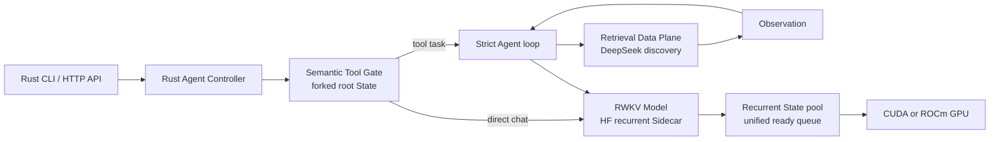
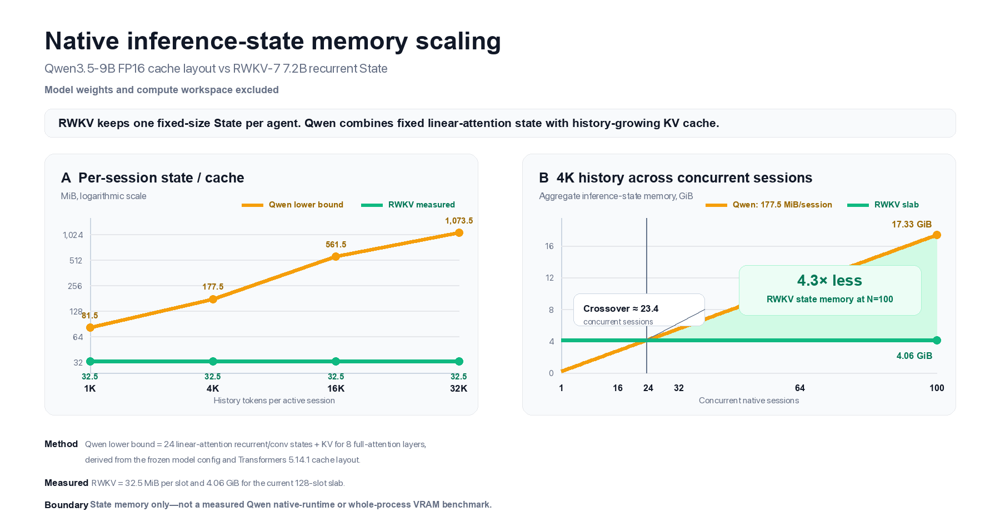

# RWKV State Agent

**A local, state-native Agent runtime for RWKV models**

RWKV State Agent reuses computed context (recurrent state) across chat turns,
executes strict tool calls, and advances many isolated agent states through one
GPU scheduler. It runs entirely on your hardware — no cloud dependency, no
data leaves the host.

## What it does

- **State-native memory:** the same session reuses its RWKV recurrent state;
  later turns compute only new tokens, not the full transcript.
- **Strict tool calls:** the model emits exactly one `<tool_call>` or
  `<answer>` envelope per turn; the controller validates the schema, budget,
  and protocol before execution.
- **Evidence-grounded search:** `web_search` discovers pages through
  DeepSeek's reranked API (or Bing/Mwmbl fallback), fetches and extracts
  them, admits candidates, and returns claim-verified cited answers — or an
  honest refusal when evidence is insufficient.
- **Controller-side citations:** the model writes plain prose without
  citation markers; the controller deterministically attaches `[W#]`
  evidence pointers after generation.
- **Deterministic recovery:** when the model repeats an already-completed
  tool call instead of answering, the controller synthesises the final
  answer from the last successful tool result.
- **Sandboxed execution:** `run_command` and file tools (`read_file`,
  `write_file`, `edit_file`) run in a Bubblewrap sandbox with no network,
  bounded output, and a configured workspace.
- **True streaming:** tokens flow from the sidecar through the Rust
  controller to any client as NDJSON deltas.
- **Independent parallel states:** jobs have separate owner, state, session,
  workspace, trace, and release lifecycle.

## Architecture



## Core tools

| Tool | Purpose |
|---|---|
| `web_search` | DeepSeek-ranked discovery, evidence admission, cited answers |
| `knowledge_search` | Local knowledge index (requires Elasticsearch) |
| `run_command` | Bounded shell command in an isolated sandbox workspace |
| `read_file` | Read one UTF-8 text file relative to `/workspace` |
| `write_file` | Atomically create or replace one UTF-8 text file |
| `edit_file` | Replace one exact text span (old_text → new_text) |

Citations, state management, task metrics, and artifact verification are
runtime features, not model-visible tools.

## HTTP API

The controller exposes a loopback HTTP API with NDJSON streaming:

```text
GET  /live                     liveness
GET  /ready                    component readiness
GET  /v1/openapi.json          OpenAPI 3.1
POST /v1/tasks                 synchronous task
POST /v1/tasks/stream          NDJSON streaming task
POST /v1/research              state-parallel multi-branch search
POST /v1/tools/call            direct tool invocation
GET  /v1/tasks/{id}            task detail
POST /v1/tasks/{id}/resume     resume from checkpoint
POST /v1/tasks/{id}/cancel     idempotent cancel
```

Requests carry identity fields (`api_version`, `request_id`, `owner_id`,
`session_id`). See `contracts/agent-service-v1.openapi.json` for the full
schema.

## Quick start

### Prerequisites

- Linux with an NVIDIA CUDA GPU (any VRAM ≥ 16 GB for a 7B model) or an
  AMD ROCm GPU
- Python 3.10+
- Rust 1.75+ for the controller and CLI
- A RWKV-7 model checkpoint (public weights from
  [HuggingFace](https://huggingface.co/RWKV) work; no private runtime needed)

### Install

```bash
git clone https://github.com/123123213weqw/rwkv-agent.git
cd rwkv-agent

# Python sidecar and data plane
python3 -m venv .venv
source .venv/bin/activate
pip install -e '.[realtime,agent]'

# Rust controller
cargo build --release --locked -p rwkv-agent-server -p rwkv-agent-cli
```

### Download a public model

```bash
export HF_ENDPOINT=https://hf-mirror.com   # if in China
python -c "from huggingface_hub import snapshot_download; \
  snapshot_download(repo_id='RWKV/RWKV7-7.2B-20260805', \
  local_dir='./models/RWKV7-7.2B')"
```

### Start the three services

```bash
# Terminal 1 — model sidecar (HF recurrent backend)
export G1I_BACKEND=hf_recurrent
export G1I_HF_MODEL_PATH=$PWD/models/RWKV7-7.2B
export G1I_HF_DTYPE=bf16
export G1I_MODEL_ID=rwkv7-7.2b-20260805
export G1I_CONTEXT=16384
export G1I_STATE_CAPACITY=8
export G1I_MAX_BATCH_SIZE=8
export G1I_PERSISTENT_STATE_CAPACITY=8
python -m rwkv_agent.sidecar --host 127.0.0.1 --port 8417

# Terminal 2 — retrieval data plane (set DEEPSEEK_API_KEY for search)
export DEEPSEEK_API_KEY=sk-...
python -m rwkv_agent.data_server \
  --host 127.0.0.1 --port 8121 \
  --model-urls http://127.0.0.1:8417 \
  --web-config configs/production.example.json

# Terminal 3 — Rust controller
./target/release/rwkv-agent-server-rs \
  --host 127.0.0.1 --port 8122 \
  --model-urls http://127.0.0.1:8417 \
  --data-plane-url http://127.0.0.1:8121 \
  --session-dir ./var/sessions \
  --tool-gate-threshold 0.0 \
  --enable-command --command-workspace ./workspaces/demo
```

### Try it

```bash
curl -sN -X POST http://127.0.0.1:8122/v1/tasks/stream \
  -H "Content-Type: application/json" \
  -H "Accept: application/x-ndjson" \
  -d '{"api_version":"rwkv-agent.service.v1","request_id":"1","owner_id":"me",
       "session_id":"s1","message":"你好，只回复你好。"}'
```

## DeepSeek search (optional)

`web_search` works without DeepSeek (falls back to Bing/Mwmbl), but
DeepSeek's reranked search API produces measurably better evidence:

1. Get an API key at [platform.deepseek.com](https://platform.deepseek.com)
2. Set `DEEPSEEK_API_KEY` in the data-plane environment
3. Search queries are billed at $0.75 / 1,000 requests

Without the key, the provider is silently skipped.

## Decode sampling (optional)

The sidecar supports env-gated sampling for experimentation; greedy decoding
is the default and is what all verified results use:

```bash
export G1I_TEMPERATURE=0.3
export G1I_TOP_P=0.9
export G1I_REPETITION_PENALTY=1.15
export G1I_PENALTY_WINDOW=64
```

On the tested RWKV-7 7.2B checkpoint, no sampled configuration beat greedy
decoding.

## AMD ROCm configuration

The project was originally verified on an AMD Radeon `gfx1100` with ROCm
7.2.1. The historical verified configuration:

| Component | Verified value |
|---|---|
| Model | RWKV-7 G1I Preview4922 13.3B |
| Context | 12,288 tokens |
| GPU | AMD Radeon gfx1100, 48 GB VRAM |
| Stable physical batch | 32 |
| Resident states | 100+ |

See `bench/baselines/` for frozen benchmark evidence from the AMD
configuration. The NVIDIA CUDA path (via the HF recurrent backend and
bundled inference runtime) is now the primary deployment target.

## State-memory scaling



The RWKV engine measures **32.5 MiB per recurrent state slot** (independent
of history length), versus a comparable attention-based model's 49.5 MiB
fixed + 32 MiB per 1K tokens. At 100 concurrent sessions, RWKV uses
**4.3× less inference-state memory**.

## Privacy and execution boundaries

- Model inference, recurrent state, transcript, workspace, and benchmark
  artifacts stay on the local host.
- `run_command` is opt-in and restricted to a configured workspace with
  Bubblewrap sandboxing (no network, bounded output, timeout).
- The HTTP controller has no public authentication. Keep it on loopback,
  use SSH forwarding, or place it behind an authenticated gateway.
- `web_search` is the only feature that uses external network sources.
- DeepSeek API keys are never committed; the data plane reads them from
  the environment.

## Repository map

```text
crates/agent-cli/       Rust terminal client
crates/agent-core/      strict tool protocol, budgets, lifecycle, events
crates/agent-runtime/   sessions, state, tools, sandbox, research, recovery
crates/agent-server/    Rust HTTP controller, streaming API
src/rwkv7_scheduler/    recurrent cache scheduler and state pool
src/rwkv_agent/         sidecar, data plane, routing, retrieval, prompts
src/rwkv_search/        realtime web retrieval, evidence admission, claims
bench/                  frozen benchmark datasets, runners, baselines
contracts/              JSON Schema / OpenAPI service contracts
docs/                   architecture, API, benchmarks, specification
```

## Known limitations

- The model's transition from tool success to final answer is the biggest
  behavioral gap on current 7B checkpoints; the controller's
  duplicate-exit recovery covers the repeat-loop mode.
- `web_search` evidence quality depends on retrieval quality;
  entity-collision on ambiguous names can produce confident but wrong
  answers (the verifier grounds to evidence, not ground truth).
- The semantic tool gate needs threshold calibration per checkpoint
  (`--tool-gate-threshold`).
- No public authentication; loopback or SSH forwarding only.
- Model weights are external to Git.

## Verification

```bash
bash scripts/verify_release.sh
```

## License

[AGPL-3.0-or-later](LICENSE)
