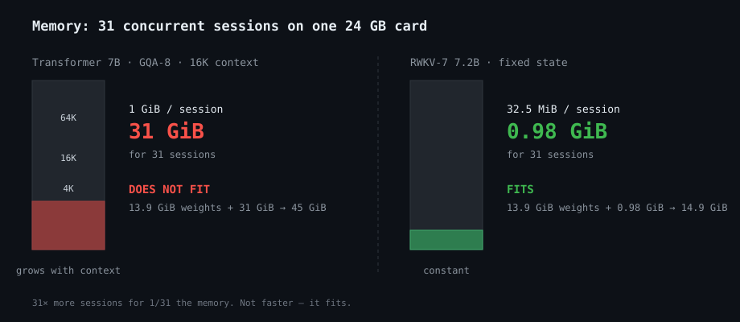
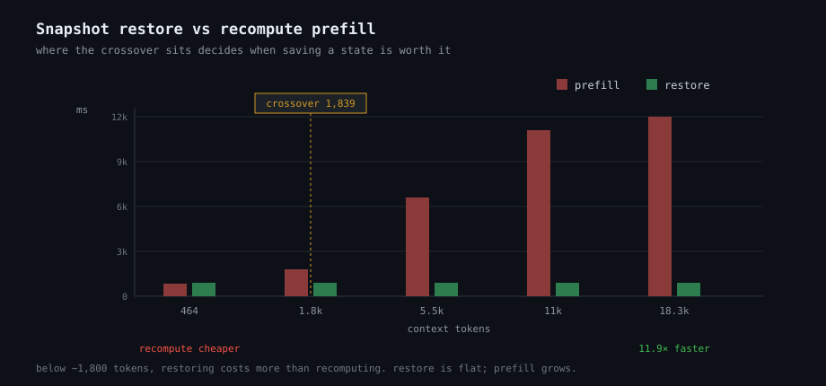
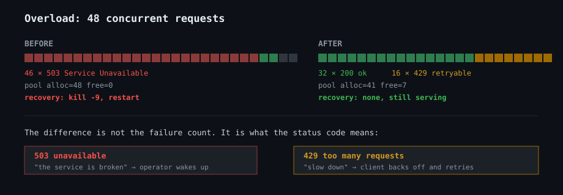
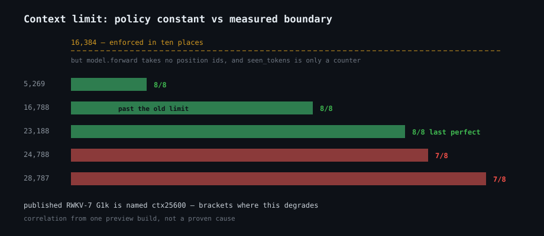
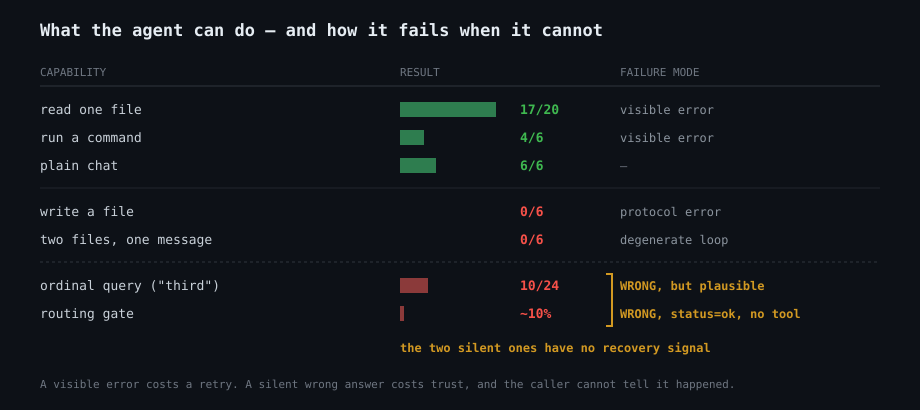

# Comparisons

The same workload measured different ways, so the differences are visible rather
than asserted. Every number is from the deployment described at the end.

---

## 1. Memory: what fits on a 24 GB card



```
                              per session      31 sessions    fits on 24 GB?
  ─────────────────────────────────────────────────────────────────────────
  transformer 7B, GQA-8, 16K     1 GiB            31 GiB      NO
  transformer 7B, GQA-8, 4K     256 MiB           7.75 GiB    yes, at 4K only
  RWKV-7 7.2B                   32.5 MiB         0.98 GiB     YES
                                                                  ▲
                                                    31x more sessions, same card
```

The 4090D has 24 GB; 13.9 GiB is model weights, leaving ~10 GiB. Transformer at
16K cannot use it at all. The comparison is not "faster", it is "fits".

---

## 2. Re-entering a conversation

```
  history        continue cost
  ─────────────────────────────────────────────────────────
    396 tok  →    246 ms   ████████████████████
  1,536 tok  →    244 ms   ████████████████████
 12,364 tok  →    242 ms   ████████████████████
  ─────────────────────────────────────────────────────────
                 0.98x over 31x more history

  transformer equivalent (recompute or cache miss)
    396 tok  →    441 ms   ████████
 12,364 tok  →  7,506 ms   ███████████████████████████████████████  (17.0x)
```

---

## 3. Snapshot and restore: where it pays off



```
   tokens   prefill    restore    winner        ratio
  ──────────────────────────────────────────────────────────
     464     501 ms     935 ms   prefill        0.54x
   1,839   1,047 ms     925 ms   break-even     1.13x   ◄── crossover
   5,513   3,828 ms     926 ms   restore        4.13x
  11,013   6,451 ms     922 ms   restore        7.00x
  18,339  10,925 ms     920 ms   restore       11.87x
  ──────────────────────────────────────────────────────────
           grows with tokens   constant

      464 tok  ████████░░░░░░░░░░░░░░  prefill wins
    1,839 tok  ██████████████░░░░░░░░  even
    5,513 tok  ████░░░░░░░░░░░░░░░░░░  restore wins 4.1x
   11,013 tok  ██░░░░░░░░░░░░░░░░░░░░  restore wins 7.0x
   18,339 tok  █░░░░░░░░░░░░░░░░░░░░░  restore wins 11.9x
```

Below ~1.8K tokens, **recomputing is cheaper**. Anything that claims "restore is
always faster" is wrong, and this is the number that decides when to use it.

---

## 4. Transport: base64 vs raw bytes

```
   state is 34,210,448 bytes

  base64  ┌────────────────────────────────────┐  43.5 MiB JSON   664 ms
          │ +33% on the wire, JSON envelope    │
          └────────────────────────────────────┘

  raw     ┌────────────────────────────────┐      32.6 MiB       456 ms
          │ octet-stream, checksum in head │
          └────────────────────────────────┘
                                                  1.3x smaller
                                                  1.5x faster
```

Both were verified byte-identical. The base64 form is still useful when the
payload has to travel inside a JSON document; the raw form is for everything else.

---

## 5. Overload: before and after



```
  BEFORE  ─────────────────────────────────────────────────────────
    n=48 concurrent
      → pool alloc=48 free=0
      → /ready: state_capacity = unavailable
      → 46 x HTTP 503
      → RECOVERY: kill -9, restart

  AFTER   ─────────────────────────────────────────────────────────
    n=48 concurrent
      → 16 x 429  "fleet at capacity: 32 of 32"
      → 32 x 200  ok
      → pool alloc=41 free=7
      → /ready stays "ready" throughout
      → RECOVERY: none needed, still serving
```

```
  status codes, n=48

  before   ████████████████████████████████████████████░  ~~~~~~~~~~
           46 × 503                                    2 × 200

  after    ████████████████████████████░░░░░░░░░░░░░░░░░
           32 × 200                16 × 429 (retryable)
```

The difference is not the count of failures. It is that 503 means "the service is
broken" and 429 means "slow down", and only one of those is recoverable without an
operator.

---

## 6. Context: policy limit vs measured limit



```
  16,384  ────────────────────────►  what the code enforces (ten places)
                                       model.forward takes no position ids;
                                       seen_tokens is only a counter

  measured, one env var changed:

     5,269 tok   ████████████████████  8/8
    16,788 tok   ████████████████████  8/8      ← past the old "limit"
    23,188 tok   ████████████████████  8/8      ← last perfect score
    24,788 tok   ███████████████████░  7/8      ← degradation starts
    28,787 tok   ███████████████████░  7/8      ← entity confusion, deterministic
```

Published RWKV-7 G1k is named `ctx25600`, which brackets where this degrades.
That is a correlation from one preview build, not a proven cause.

---

## 7. Where the agent can and cannot act



```
  capability                   result   failure mode
  ────────────────────────────────────────────────────────────────
  read one file                17/20    protocol error (visible)
  run a command                 4/6     protocol error (visible)
  plain chat                    6/6     —
  ────────────────────────────────────────────────────────────────
  write a file                  0/6     protocol error (visible)
  two files, one message        0/6     degenerate loop (visible)
  ordinal query ("third")      10/24    WRONG, but plausible
  routing gate                 ~10%     WRONG, status=ok, no tool
  ────────────────────────────────────────────────────────────────
                                        ▲
                          the two silent failures are the dangerous ones:
                          the caller cannot distinguish them from success
```

A visible error costs a retry. A silent wrong answer costs trust, and there is no
signal that it happened.

---

## 8. What the pool buys and does not buy

```
  ┌──────────────────────────────────────┬───────────────────────────────┐
  │ BUYS                                 │ DOES NOT BUY                  │
  ├──────────────────────────────────────┼───────────────────────────────┤
  │ allocation is O(1) after startup     │ single-stream speed (13.2 ms  │
  │ reuse is 44-72 ms vs 8,758 ms to     │   per token comes from the    │
  │   rebuild a 13.2K state   (200x)     │   kernels and bandwidth)      │
  │ slot identity is safe (generation    │ state reuse (that is an       │
  │   counter + zeroing on allocate)     │   architecture property)      │
  │ capacity is an integer comparison    │ any protection against        │
  │                                      │   exhaustion on its own       │
  └──────────────────────────────────────┴───────────────────────────────┘
```

The last cell is why admission control had to be added separately. A pool gives
you counting; it does not force you to count at the right moment.

---

## Measured on

```
model      rwkv-g1l-7b-temp-3797
revision   preview3260          ← G1L is unpublished
backend    Albatross faster3a_2607
hardware   1 × RTX 4090D, 24 GB
state      34,078,724 B per slot
```

These boundaries should be re-measured on a public checkpoint before being
generalised. See [MECHANISMS.md](MECHANISMS.md) for how each mechanism works.
